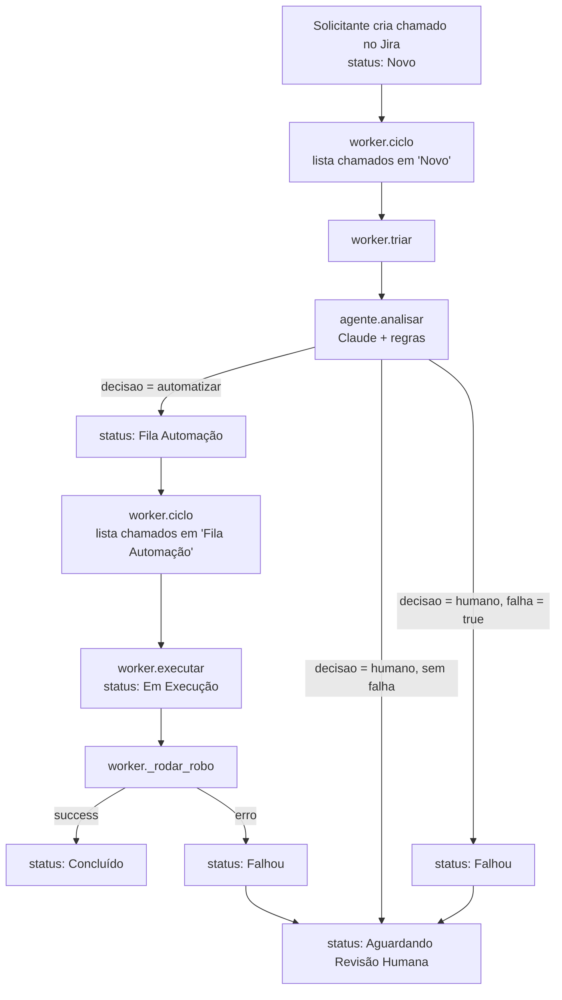

# Fluxo completo do projeto

Este documento segue um chamado desde a criação no Jira até o encerramento (ou o envio ao humano). Para cada passo ele mostra **qual função roda, em qual arquivo e o que ela faz**. Descreve o código como está hoje (após a reorganização em `models/` e `service/`).

## 1. Mapa das pastas

```
src/
  worker.py        # orquestrador: loop que liga todas as peças
  config.py        # Settings (lê .env: Jira, Anthropic, planilha)
  agent/
    prompt.py      # SYSTEM (regras do agente) + montar_pedido()
    tools.py       # ferramentas (tool calling) que o Claude escolhe
    agente.py      # analisar(): chama o Claude, valida e decide
    resposta.py    # montar_descricao(): texto da Description do chamado
  models/
    ticket.py      # Ticket
    agente.py      # Atividade, Proposta, Analise, Dados*
    rpa.py         # RpaResult, PedidoForm, CalculoForm, EMPRESAS
  service/
    jira_client.py # JiraClient (API REST v3)
    regras.py      # validações determinísticas (o código decide)
    registro.py    # registro local das análises (evidencias/analises.jsonl)
    calculadora.py # RPA desktop (pywinauto)
    pw_forms.py    # RPA web (Playwright + Google Forms)
    consulta.py    # consulta de pedidos (DuckDB sobre planilha do Google)
backend/           # API FastAPI do painel (lê e cria chamados pelo JiraClient)
  main.py          # app + routers
  routers/         # chamados.py (listar, detalhar, anexos, criar) e metricas.py
  metricas.py      # cálculo das métricas a partir dos chamados do Jira
  deps.py          # JiraClient compartilhado e cache
  schemas.py       # schemas Pydantic do painel
frontend/          # painel web (React + Vite); fora do fluxo do worker
```

O `backend/` e o `frontend/` não participam do ciclo do worker: só criam chamados (que nascem em `Novo`) e mostram o que o worker gravou no Jira. Este documento foca no worker.

Princípio central: **o modelo propõe, o código decide.** O Claude só escolhe a atividade e extrai dados. Quem aprova ou manda para o humano são as regras em `service/regras.py`.

## 2. Visão geral



Os status do Jira funcionam como as filas. Um único processo (o worker) varre `Novo` e depois `Fila Automação` a cada rodada.

## 3. Passo 0 — Criação do chamado

O solicitante abre um chamado do tipo `Ticket` no Jira e preenche:

| Campo | Quem preenche |
|---|---|
| Summary | Solicitante (texto do pedido, até 255 caracteres) |
| Área Solicitante | Solicitante (RH, Operations, Comercial) |
| Categoria, Decisão, Priority | Agente (preenchidos na triagem) |
| Description | Sistema (resposta ao solicitante, preenchida depois) |

O chamado nasce no status `Novo`. Também dá para criar por código ou pelo painel (`POST /chamados` do backend) com `JiraClient.create_ticket(summary, area, description, priority)` ([jira_client.py](../src/service/jira_client.py)), que monta os campos (o ID do campo "Área Solicitante" vem de `field_ids()`), faz o `POST /issue` e devolve o `Ticket` já lido de volta.

## 4. Passo 1 — O worker acorda (`src/worker.py`)

`main()` cria o `JiraClient`, configura o log e entra em `while True: ciclo(jira); time.sleep(intervalo)`. `Ctrl+C` encerra e fecha o cliente HTTP no `finally`.

`ciclo(jira)` faz uma rodada com duas etapas, nesta ordem:

| Fila (status) | Etapa chamada |
|---|---|
| `Novo` | `triar` |
| `Fila Automação` | `executar` |

Para cada fila:
1. `jira.tickets_in_status(status)` monta o JQL `project = "X" AND status = "..." ORDER BY created ASC` (mais antigos primeiro) e chama `search()`.
2. `search()` usa `GET /rest/api/3/search/jql` com paginação por token (`nextPageToken`) e converte cada issue com `_to_ticket()`.
3. Se listar falhar (`JiraError`), registra o erro e passa para a próxima fila. A rodada não cai.
4. Para cada chamado chama `_processar(jira, ticket, etapa)`.

Como a triagem roda antes na mesma rodada, um chamado aprovado em `Novo` pode ser executado já no mesmo ciclo.

`_processar` é a **rede de segurança**: roda a etapa dentro de `try/except`. Se qualquer exceção escapar, registra o erro, comenta no chamado "Erro do sistema ao processar o chamado: ..." e o envia ao humano passando por `Falhou`. Se nem isso funcionar (Jira fora do ar), só registra no log e o chamado é tentado de novo na rodada seguinte. Falha em um chamado nunca derruba o worker.

### Como `JiraClient` lê os dados (`_to_ticket`, `field_ids`)

- `field_ids()` descobre os IDs dos campos personalizados (Área, Categoria, Decisão) pela API de metadados (`createmeta`) na primeira chamada e guarda em cache. Podem ser sobrescritos por configuração. Nada de `customfield_XXXX` fixo no código.
- `_adf_to_text()` converte a Description (formato ADF do Jira) em texto puro.
- `_to_ticket()` monta o `Ticket` (`key, summary, description, status, priority, area, categoria, decisao, created, anexos` e `passou_por_falhou`). `passou_por_falhou` é lido do changelog (`expand=changelog`) e só vem preenchido quando a busca pede o histórico (`get_ticket`, `search(..., changelog=True)`, `all_tickets`); o painel usa isso nas métricas.
- Outros métodos de leitura usados pelo painel: `get_ticket(key)`, `all_tickets()` e `attachment_content(key, id)` (baixa o anexo).
- `_request()` é a base de todas as chamadas HTTP: tenta até 3 vezes em caso de 429 (respeitando `Retry-After`), transforma erro de rede ou HTTP em `JiraError` e loga com o ID do chamado.

## 5. Passo 2 — Triagem (`worker.triar`)

```python
analise = analisar(ticket)        # 5.1
salvar_analise(analise)           # 5.2
jira.update_fields(...)           # 5.3
jira.add_json_comment(...)        # 5.3
jira.set_description(...)         # 5.3
# depois: transição de status    # 5.4
```

### 5.1 `agente.analisar(ticket)` ([agente.py](../src/agent/agente.py))

Nunca levanta exceção. Sempre devolve uma `Analise`.

**a) Monta o pedido.** `prompt.montar_pedido(ticket)` gera:
```
Chamado ID-12 (área solicitante: RH).
<chamado>
{ticket.text}
</chamado>
Chame a ferramenta adequada.
```
- `ticket.text` ([ticket.py](../src/models/ticket.py)) devolve **só o Summary**. A Description não entra, porque ela é a resposta do sistema.
- O texto vai dentro de `<chamado>` e o `SYSTEM` ([prompt.py](../src/agent/prompt.py)) diz ao modelo que aquilo é dado, não instrução (defesa contra prompt injection).

**b) Chama o Claude.** `_chamar_llm(ticket, client)`:
- Cria o cliente com `_cliente()` (usa `ANTHROPIC_API_KEY`; sem chave levanta `AgenteError`).
- `client.messages.create(...)` com `system=SYSTEM`, `tools=FERRAMENTAS`, `tool_choice` automático sem uso paralelo de ferramentas, `effort: low`.
- **Escolher a ferramenta = escolher a atividade.** As 4 ferramentas ([tools.py](../src/agent/tools.py)) e o mapeamento `FERRAMENTA_PARA_ATIVIDADE`:

| Ferramenta | Atividade | Dados que o modelo extrai |
|---|---|---|
| `calcular_na_calculadora` | `calculadora` | `a`, `b`, `operacao` |
| `preencher_formulario_pedido` | `formulario` | `cliente`, `valor_pedido`, `qtd_produtos`, `empresa` |
| `consultar_pedidos` | `consulta` | `colunas`, `filtros[{coluna, operador, valor}]`, `agregacao{operacao, coluna}` (ou `null`), `agrupar_por` |
| `encaminhar_para_humano` | `humano` | nenhum |

- Todas as ferramentas também trazem os campos comuns: `categoria`, `prioridade`, `resumo`, `justificativa`, `confianca`, `referencias_chamados`, `acao_ampla`.
- Os campos de dados aceitam `null` ("Nunca invente"). O schema é `strict`.
- Valida a resposta: precisa ter **exatamente uma** chamada de ferramenta e `stop_reason` diferente de `refusal`. Senão levanta `RespostaInvalida`. O `uso.input` vira um `Proposta` (Pydantic); se estiver fora do schema, também `RespostaInvalida`.

**c) Tentativas e falha.**
- `RespostaInvalida` → tenta **mais uma vez** a chamada.
- `AgenteError` (API fora, chave ausente, segunda resposta inválida) → `_falha_do_agente(ticket, motivo)` devolve uma `Analise` com `atividade = humano`, `decisao = humano`, `falha = True`, `confianca = 0.0` e o motivo em `erros`.

**d) Validação determinística** (só se a atividade não for `humano`):
- `validar_dados(atividade, proposta.dados)` → lista de **erros** (dado ausente, inválido, inexistente)
- `validar_alertas(ticket, proposta)` → lista de **alertas** (regras 2 e 3 do projeto)

**e) Decisão final:**
```python
automatizar = atividade is not HUMANO and not erros and not alertas
decisao = "automatizar" if automatizar else "humano"
falha   = bool(erros)
```

A confiança informada pelo modelo é registrada na análise, mas não bloqueia a automação: não há limiar de confiança (decisão do Matheus, já que as validações de dados e os alertas cobrem os casos).

### 5.1.1 As regras (`service/regras.py`)

Funções puras (sem rede, sem LLM).

`validar_dados` roteia por atividade:

| Validador | O que checa | Erro produzido |
|---|---|---|
| `validar_calculadora` | `a`, `b`, `operacao` presentes; passam em `CalculoForm` (número válido, operação em `+ - * /`); divisão por zero | `dado ausente no chamado: ...`, `valor inválido em '...'`, `divisão por zero` |
| `validar_formulario` | os 4 campos presentes; passam em `PedidoForm` (valor monetário, quantidade inteira, empresa em `COMP/ENG/DESK`) | `campos obrigatórios ausentes no chamado: ...`, `empresa deve ser uma de: ...` |
| `validar_consulta` | colunas (de seleção, filtro, agrupamento e agregação) existem em `COLUNAS_PEDIDOS` (`timestamp, cliente, valor, qnt_produtos, empresa`); há ao menos um filtro **ou** uma agregação; filtro com valor e operador válido (`= != > >= < <=`); coluna numérica (`valor`, `qnt_produtos`) exige número; `> >= < <=` só em colunas numéricas; agregação com operação válida (`soma, contagem, media, maximo, minimo`) e, fora a contagem, coluna numérica; `agrupar_por` só `cliente` ou `empresa` e só com agregação | `coluna(s) inexistente(s) na base`, `consulta sem filtro...`, `filtro sem valor`, `operador de filtro inválido`, `filtro em '...' exige número`, `operador '...' só vale para colunas numéricas`, `... sem coluna`, `não dá para calcular ...`, `não dá para agrupar por: ...`, `agrupamento sem agregação` |

Se os dados extraídos vierem em formato inesperado, `validar_dados` devolve `dados extraídos em formato inesperado`.

`validar_alertas` (não são falha de dado, mas mandam ao humano):
- O texto cita **mais de um** outro chamado → "possível inconsistência, nenhum chamado deve ser atualizado".
- O texto cita **um** outro chamado diferente do próprio → alerta.
- O próprio ID do chamado não conta como referência.
- `acao_ampla = true` → "exige validação humana".

### 5.2 `registro.salvar_analise(analise)` ([registro.py](../src/service/registro.py))

Anexa uma linha JSON (`quando` + `analise`) em `evidencias/analises.jsonl`. Serve para avaliação/monitoramento e como **memória do worker**: na execução, o chamado usa a mesma análise que o aprovou.

### 5.3 Devolvendo a análise ao Jira

| Chamada | O que grava no Jira |
|---|---|
| `jira.update_fields(categoria, decisao, priority)` | Categoria (do agente), Decisão (`Automatizar` ou `Decisão Humana`) e Priority |
| `jira.add_json_comment(chamado, analise.model_dump(), "Análise do agente")` | Comentário com a análise completa em bloco de código JSON |
| `jira.set_description(chamado, montar_descricao(analise))` | Resposta curta ao solicitante na Description |

`montar_descricao(analise)` ([resposta.py](../src/agent/resposta.py)) escolhe o texto assim (sem resultado de RPA):

| Situação | Texto |
|---|---|
| Falha do próprio agente (`falha` e atividade `humano`) | "Não foi possível analisar o chamado (erro técnico, ver log)." + encaminhado |
| Falha de dado (`falha`) | "Não foi possível automatizar: {erros}." + encaminhado |
| Decisão humana (`decisao == humano`) | "Esta solicitação não pode ser feita pela automação: {justificativa; alertas}." + encaminhado |
| Aprovado | "Chamado aprovado para a automação." |

### 5.4 Para onde o chamado vai

| Resultado da análise | Transições executadas |
|---|---|
| `decisao = automatizar` | `transition_to` → **Fila Automação** |
| `decisao = humano`, `falha = False` (fora do escopo, ambíguo, alerta) | → **Aguardando Revisão Humana** |
| `decisao = humano`, `falha = True` (dado faltando/inválido, agente falhou) | → **Falhou** → **Aguardando Revisão Humana** |

Isso é feito por `_enviar_ao_humano(jira, chamado, falha)`. `transition_to` lista as transições disponíveis (`GET .../transitions`), procura a que leva ao status desejado e a executa (`POST`). Se não existir, levanta `JiraError`. O status nunca é editado direto.

## 6. Passo 3 — Execução (`worker.executar`)

Roda para chamados em `Fila Automação`.

1. `jira.transition_to(chamado, "Em Execução")`.
2. **Recupera a análise:** `registro.buscar_analise(chamado)` (a última registrada). Se não achar (registro apagado), roda `analisar(ticket)` de novo.
3. **Garantia extra:** se a análise recuperada não for `automatizar`, atualiza a Description e envia ao humano (`_enviar_ao_humano`), sem rodar robô.
4. **Roda o robô:** `rpa = _rodar_robo(analise, chamado)` (6.1).
5. **Anexa evidências:** para cada arquivo em `rpa.evidencias`, `_anexar(...)` → `jira.attach(...)`. Falha ao anexar só gera aviso no log e não trava o chamado.
6. **Atualiza a Description:** `montar_descricao(analise, rpa)`.
7. **Fecha o chamado:**

| Resultado do robô | Ação |
|---|---|
| `rpa.success = True` | → **Concluído** |
| `rpa.success = False` | `add_comment("Falha do robô: ...")` → **Falhou** → **Aguardando Revisão Humana** |

Textos da Description com resultado do robô (`montar_descricao` com `rpa`):

| Situação | Texto |
|---|---|
| Sucesso, calculadora | "Resultado: 7 + 3 = 10 (conferido)." |
| Sucesso, formulário | "Pedido registrado no formulário: cliente ..., valor ..., N produto(s), empresa ..." |
| Sucesso, consulta | "Resultado da consulta: " + mensagem do robô (lista de pedidos ou valor agregado) |
| Falha | "Falha na execução da automação: {mensagem}" + encaminhado |

### 6.1 `worker._rodar_robo(analise, chamado)`

Limpa os espaços dos dados extraídos e escolhe o robô pela atividade:

| Atividade | Chamada | Modelo de entrada |
|---|---|---|
| `calculadora` | `calcular(CalculoForm(**dados), ticket=chamado)` | `CalculoForm` |
| `formulario` | `preencher_formulario(PedidoForm(**dados), ticket=chamado)` | `PedidoForm` |
| `consulta` | `consultar(colunas, filtros, ticket=chamado, agregacao=..., agrupar_por=...)` | listas e tuplas simples (`filtros` como `(coluna, operador, valor)`, `agregacao` como `(operacao, coluna)`) |

Os robôs já devolvem `RpaResult` sem levantar exceção. O `try/except` do worker é só a última barreira: converte qualquer erro inesperado em `RpaResult(success=False, ...)`. Todos devolvem o mesmo contrato: `RpaResult(success, message, evidencias)`.

### 6.2 Calculadora — [calculadora.py](../src/service/calculadora.py) (pywinauto)

`calcular(dados, ticket, evidencias_dir)`:
1. Cria a pasta `evidencias/<ID>/`.
2. `_abrir()` executa `calc.exe` e localiza a janela da Calculadora pela classe/título (no Windows 11 o `calc.exe` é só um lançador).
3. `_clicar("clearButton")` limpa.
4. `_digitar(a)` clica botão a botão (trata sinal negativo e separador decimal), `_clicar(operador)`, `_digitar(b)`, `_clicar("equalButton")`.
5. `_ler_visor()` lê o resultado na tela e `_print()` salva `calculadora.png`.
6. **Validação determinística:** o código calcula o resultado esperado com `Decimal` e compara com o visor (`_numero_do_visor`, respeitando o arredondamento exibido). Se divergir, levanta `ValueError`.
7. Sucesso: `RpaResult(True, "7 + 3 = 10 (conferido)", [calculadora.png])`.
8. Qualquer exceção: tenta tirar `erro.png` e devolve `RpaResult(False, "Falha na Calculadora: ...")`.
9. O `finally` fecha a Calculadora (`_fechar`, melhor esforço).

### 6.3 Formulário web — [pw_forms.py](../src/service/pw_forms.py) (Playwright)

`preencher_formulario(dados, ticket, evidencias_dir, headless=True, timeout_ms=15000)`:
1. Abre o Chromium (locale `pt-BR`) e inicia o `tracing` (screenshots + snapshots).
2. `page.goto(FORM_URL)` e `_preencher()`: preenche cliente, valor e quantidade (`_textbox` localiza pelo rótulo da pergunta) e marca o rádio da empresa.
3. `_shot()` salva `1_preenchido.png`.
4. Clica em "Enviar" e espera o texto "Sua resposta foi registrada". Se não aparecer, lê os alertas do formulário e levanta `PlaywrightError("envio não confirmado; erros do formulário: ...")`.
5. Sucesso: salva `2_confirmacao.png` e devolve `RpaResult(True, "Resposta registrada no formulário", [...])`.
6. Em erro: salva `erro.png` e `trace.zip` (trace do Playwright), fecha tudo e devolve `RpaResult(False, "Falha no formulário: ...", evidencias)`.

### 6.4 Consulta — [consulta.py](../src/service/consulta.py) (DuckDB)

`consultar(colunas, filtros, ticket, agregacao, agrupar_por)`:
1. `_abrir_planilha(url)` baixa o CSV da planilha pública do Google (`httpx`) e carrega na tabela `pedidos` do DuckDB. Erro de rede ou DuckDB → `RpaResult(False, "falha ao consultar a planilha: ...")`.
2. `executar_consulta` chama `montar_sql`, que normaliza os nomes de coluna (`normalizar_coluna`: minúsculas, `_` no lugar de espaço). Sem colunas pedidas (e sem agregação), usa `cliente, valor, qnt_produtos, empresa`.
3. `montar_sql` confere tudo contra listas fixas e levanta `ValueError` (vira `RpaResult(False, ...)`) se algo falhar: coluna fora de `COLUNAS_PEDIDOS`, operador fora de `OPERADORES_FILTRO`, agrupamento fora de `cliente`/`empresa`, agrupamento sem agregação, operação de agregação inválida, cálculo em coluna não numérica.
4. Monta o SQL: **nomes de coluna, operadores e operações** só entram se estiverem nas listas fixas, e os **valores** vão sempre como parâmetros `?`. Colunas numéricas comparam como `DOUBLE` (aceita vírgula decimal), e textos com `lower()` (só `=` e `!=`).
5. Dois modos:
   - **Lista:** `SELECT colunas FROM pedidos WHERE ...`.
   - **Agregação:** `SUM/COUNT/AVG/MAX/MIN` sobre a coluna numérica, com `GROUP BY` e `ORDER BY` quando há `agrupar_por`.
6. Executa o SQL. Erro do DuckDB → `RpaResult(False, "falha ao consultar a planilha: ...")`.
7. Sem resultado (lista vazia, ou agregação sem linhas, que devolve `NULL`) → `RpaResult(False, "nenhum pedido encontrado com esses filtros")` (isso **conta como falha**, e o chamado vai ao humano).
8. Com resultado, a mensagem depende do modo:
   - Lista: `"N pedido(s) encontrado(s):\n..."`.
   - Agregação simples: `"soma de valor (cliente = Jonas): 1234"`.
   - Agregação agrupada: `"soma de valor por empresa:\nCOMP: 100\n..."`.

A consulta não gera evidência em arquivo (não há tela).

## 7. Todos os caminhos possíveis

| # | Situação | Onde é detectada | Caminho no Jira |
|---|---|---|---|
| 1 | Pedido válido de calculadora, formulário ou consulta e robô funciona | `analisar` aprova, `_rodar_robo` com sucesso | Novo → Fila Automação → Em Execução → **Concluído** |
| 2 | Pedido fora do escopo ou ambíguo (Claude escolhe `encaminhar_para_humano`) | `analisar` | Novo → **Aguardando Revisão Humana** |
| 3 | Dado ausente ou inválido (ex.: "somar 5", empresa inexistente, coluna inexistente, divisão por zero) | `validar_dados` | Novo → **Falhou** → **Aguardando Revisão Humana** |
| 4 | Referência a outro chamado ou a vários chamados (inconsistência) | `validar_alertas` | Novo → **Aguardando Revisão Humana** |
| 5 | Ação ampla ou sensível (ex.: encerrar todos os chamados de uma área) | `acao_ampla` → `validar_alertas` | Novo → **Aguardando Revisão Humana** |
| 6 | API do Claude falha ou resposta fora do contrato duas vezes | `analisar` → `_falha_do_agente` | Novo → **Falhou** → **Aguardando Revisão Humana** |
| 7 | O robô falha (tela inesperada, resultado divergente, formulário não confirma, consulta sem resultado) | `_rodar_robo` devolve `success=False` | Fila Automação → Em Execução → **Falhou** → **Aguardando Revisão Humana** (com comentário e evidências) |
| 8 | Erro inesperado na etapa (bug, exceção do Jira no meio) | `_processar` | comentário "Erro do sistema..." → **Falhou** → **Aguardando Revisão Humana** |
| 9 | Jira fora do ar durante o tratamento de erro | `_processar` | só log; o chamado é tentado de novo na rodada seguinte |
| 10 | Registro da análise não existe na execução | `executar` | analisa de novo e segue (se virar humano, vai ao humano sem robô) |

Os casos 3 e 4 diferem de propósito: **dado faltando é falha** (passa por `Falhou`, `falha=True`), e **alerta é decisão** (vai direto ao humano, `falha=False`).

## 8. O que o humano recebe

Todo chamado enviado a `Aguardando Revisão Humana` carrega:
- **Comentário JSON** "Análise do agente" com `numero_chamado, area, categoria, atividade, prioridade, resumo, dados_extraidos, decisao, justificativa, confianca, falha, erros, alertas`.
- **Description** com o motivo em linguagem simples.
- **Categoria, Decisão e Priority** preenchidas.
- Quando houve robô: comentário "Falha do robô: ..." e **anexos** (screenshots e `trace.zip`).

## 9. Onde ficam os registros

| O quê | Onde |
|---|---|
| Log estruturado (ID do chamado em cada linha) | terminal (módulo `logging`, loggers `worker`, `jira`, `agente`, `registro`, `consulta`, `rpa.*`) |
| Análises (uma linha JSON por análise) | `evidencias/analises.jsonl` |
| Evidências do robô | `evidencias/<ID-do-chamado>/` (também anexadas ao Jira) |

