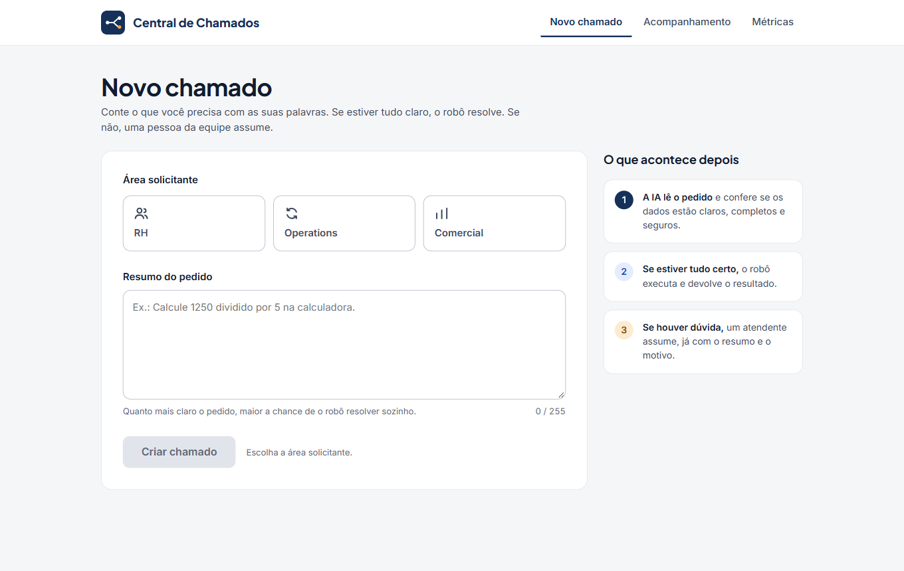
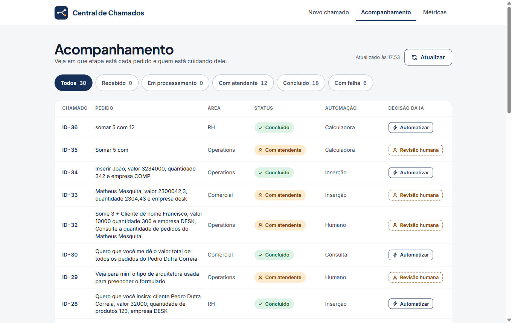
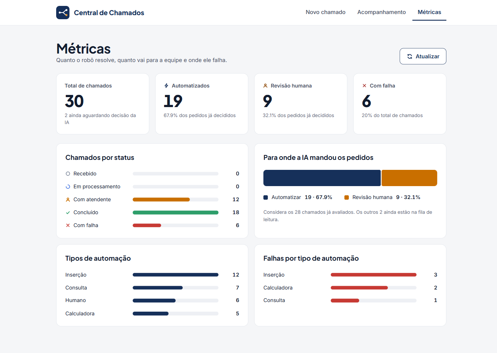
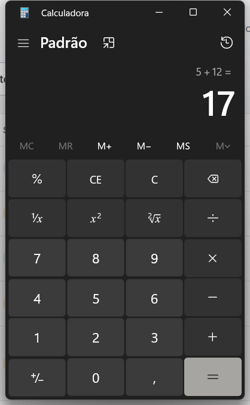
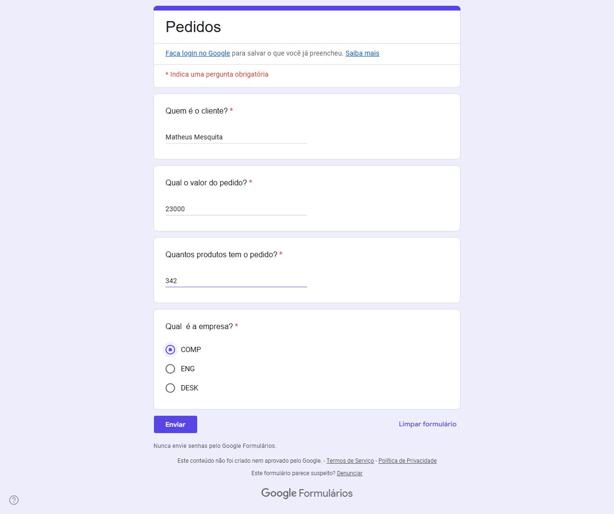
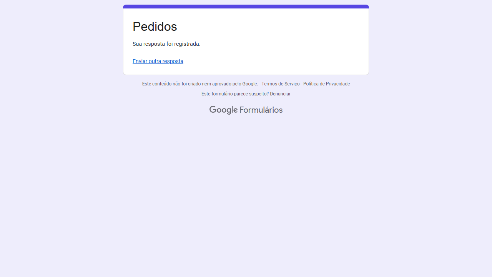

# AI Ticket Manager

Um agente de IA + robôs (RPA) que tratam chamados abertos no **Jira**.

O chamado chega, a IA lê o pedido e decide: **dá para automatizar?** Se sim, um robô executa a tarefa e devolve o resultado no próprio chamado. Se não (dado faltando, pedido ambíguo, ação sensível), o chamado vai para uma **pessoa revisar**.

## Como funciona

```
Novo → (IA analisa)
   ├─ automatizar → Fila Automação → Em Execução → Concluído
   │                                      └─ erro → Falhou → Aguardando Revisão Humana
   └─ humano ────────────────────────────────────→ Aguardando Revisão Humana
```

1. **Entrada:** o chamado é criado no Jira (direto lá ou pelo painel web) com status `Novo`.
2. **Análise:** o worker envia o texto do chamado ao Claude (Anthropic), que devolve um JSON com categoria, prioridade, dados extraídos, decisão e justificativa.
3. **Validação:** regras em código (não só o LLM) conferem se os dados estão completos e se a atividade é permitida. O modelo propõe, o código decide.
4. **Execução:** se aprovado, o robô roda e anexa screenshots/logs como evidência. Os robôs disponíveis são:
   - **Calculadora** do Windows (pywinauto)
   - **Formulário web** do Google Forms (Playwright)
   - **Consulta de pedidos** em uma planilha pública (DuckDB)
5. **Retorno:** o resultado volta ao chamado como comentário, e o status é atualizado. Falhas e casos duvidosos vão para `Aguardando Revisão Humana`, com os dados extraídos e o motivo.

O projeto tem três partes:

| Pasta | O que é |
|---|---|
| `src/` | O worker, o agente de IA e os robôs |
| `backend/` | API (FastAPI) usada pelo painel |
| `frontend/` | Painel web (React + Vite): criar chamado, acompanhar e ver métricas |

## Veja funcionando

Capturas reais da execução, com chamados de verdade no Jira.

### Painel web

**Novo chamado:** o solicitante escolhe a área e descreve o pedido com as próprias palavras.



**Acompanhamento:** cada pedido com a etapa atual, a automação escolhida e a decisão da IA (`Automatizar` ou `Revisão humana`).



**Métricas:** quanto o robô resolve, quanto vai para a equipe e em qual tipo de automação ele falha. Os números saem direto do Jira.



### Robôs (RPA) com evidência

Cada execução gera screenshots que são anexados ao chamado no Jira.

| Calculadora do Windows (pywinauto) | Google Forms (Playwright) |
|---|---|
|  |  |
| Chamado `ID-36`: *"somar 5 com 12"* → resultado **17** | Chamado `ID-21`: dados extraídos do texto e preenchidos no formulário |

Depois do envio, o robô captura também a tela de confirmação:



### A IA não inventa dado

Quando falta informação, o chamado vai para uma pessoa em vez de o robô chutar. Exemplo real (`ID-35`, *"Somar 5 com"*): a IA extraiu `a = 5`, `b = null` e decidiu **revisão humana**, com o motivo registrado no chamado:

```json
{
  "numero_chamado": "ID-35",
  "categoria": "Calculadora",
  "dados_extraidos": { "a": "5", "b": null, "operacao": "+" },
  "decisao": "humano",
  "justificativa": "Pedido de soma na calculadora, mas o segundo número não foi informado no chamado.",
  "erros": ["dado ausente no chamado: segundo número"]
}
```

## Pré-requisitos

- **Windows** (a automação da Calculadora usa pywinauto)
- [Python 3.14](https://www.python.org/downloads/) e [uv](https://docs.astral.sh/uv/)
- [Node.js](https://nodejs.org/) (para o painel)
- Uma conta no **Jira Cloud** com um projeto *team-managed* (chave `ID`, tipo de item `Ticket`), com os status `Novo`, `Fila Automação`, `Em Execução`, `Aguardando Revisão Humana`, `Concluído` e `Falhou`, e os campos `Área Solicitante`, `Categoria` e `Decisão`
- Um [token de API do Jira](https://id.atlassian.com/manage-profile/security/api-tokens)
- Uma chave de API da [Anthropic](https://console.anthropic.com/)

## Como executar

**1. Clone o repositório**

```bash
git clone <url-do-repositorio>
cd ai-ticket-manager
```

**2. Instale as dependências do Python**

```bash
uv sync
uv run playwright install chromium
```

**3. Configure as credenciais**

Copie o arquivo de exemplo e preencha:

```bash
copy .env.example .env
```

```env
JIRA_BASE_URL=https://seu-site.atlassian.net
JIRA_EMAIL=seu-email@exemplo.com
JIRA_API_TOKEN=seu-token-do-jira
ANTHROPIC_API_KEY=sua-chave-da-anthropic
```

Opcionais: `JIRA_PROJECT_KEY` (padrão `ID`), `JIRA_ISSUE_TYPE` (padrão `Ticket`) e `ANTHROPIC_MODEL` (padrão `claude-haiku-5-5`).

> O `.env` não vai para o git. Nunca compartilhe seus tokens.

**4. Inicie o worker** (processa os chamados em loop, a cada 15 s)

```bash
uv run python -m src.worker
```

Para mudar o intervalo: `uv run python -m src.worker --intervalo 30`.

Pronto: crie um chamado no Jira com status `Novo` e acompanhe o terminal. Durante a execução, o robô abre a Calculadora ou o navegador na sua tela. Não mexa no mouse/teclado nesse momento.

**5. (Opcional) Suba o painel web**

Em outros dois terminais:

```bash
# API, na raiz do projeto (porta 8000)
uv run uvicorn backend.main:app --reload
```

```bash
# Painel, dentro de frontend/ (porta 5173)
cd frontend
copy .env.example .env
npm install
npm run dev
```

Abra http://localhost:5173.

## Onde ver os resultados

- **No Jira:** status, comentário estruturado (decisão, confiança, justificativa, dados extraídos) e anexos de evidência em cada chamado.
- **Na pasta `evidencias/`:** screenshots e logs, organizados por chamado.
- **No painel:** acompanhamento dos chamados e métricas (automação × humano, categorias, chamados que falharam).

